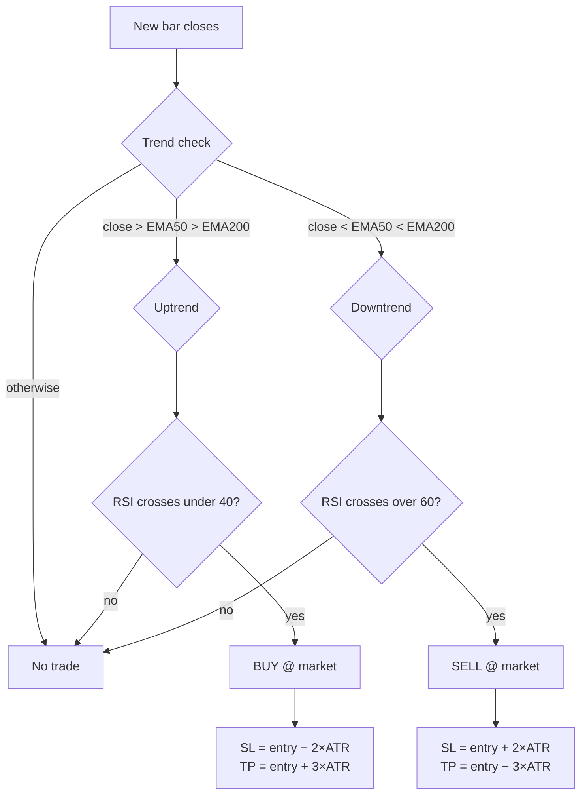

# Pine Script → MQL5 EA Conversion

> **The same strategy, twice.** A complete, side-by-side demonstration of converting a TradingView Pine Script strategy into a production-style MQL5 Expert Advisor — identical logic, identical parameters, identical risk model.

If you've ever wondered *"how do I turn my TradingView idea into something MetaTrader 5 can actually trade?"* — this repo is the answer, line by line.

---

## The Strategy: EMA Trend + RSI Pullback

Trade **with** the trend, enter **on** the pullback. No black boxes — every rule is readable in both languages.

**Rules, in plain English:**

| # | Rule |
|---|------|
| 1 | **Trend filter** — longs only when `close > EMA(50) > EMA(200)`; shorts only for the mirror |
| 2 | **Trigger** — in an uptrend, enter when RSI(14) crosses *under* 40 (the pullback); in a downtrend, when it crosses *over* 60 |
| 3 | **Risk** — stop loss at 2× ATR(14), take profit at 3× ATR(14), set at entry |
| 4 | **Discipline** — one position at a time, evaluated on bar close only |

---

## Files

| File | What it is |
|------|-----------|
| `ema-rsi-pullback.pine` | The strategy in **Pine Script v5** — paste into TradingView's Pine Editor |
| `EMA_RSI_Pullback.mq5` | The **MQL5 Expert Advisor** — drop into `MQL5/Experts`, compile with F7 in MetaEditor |

---

## Pine → MQL5 Concept Map

The heart of this repo. Every Pine idiom has an MQL5 counterpart — here's the Rosetta Stone:

| Pine Script | MQL5 | Notes |
|---|---|---|
| `strategy(...)` | `OnTick()` + `CTrade` | Pine's strategy engine becomes an event handler plus the standard trade class |
| `ta.ema / ta.rsi / ta.atr` | `iMA / iRSI / iATR` handles + `CopyBuffer` | Create handles **once** in `OnInit()`; read buffers per bar — the MQL5 way |
| Bar-close evaluation | `NewBar()` via `CopyTime` | Both versions trade on confirmed bars only, never intra-bar |
| `rsiVal[1]` (history) | Buffer index math | Pine series are newest-last; `CopyBuffer` fills oldest-first, so `rsiVal[1]` → `rsi[1]` with `start_pos=1, count=3` |
| `ta.crossunder(rsi, 40)` | `rsi1 < 40 && rsi2 >= 40` | Crosses are manual comparisons of the last two closed bars |
| `input.int / input.float` | `input int / input double` | One-to-one — same names, same defaults |
| `strategy.entry("Long", ...)` | `trade.Buy(lots, _Symbol, 0, sl, tp)` | Price `0` = market order, mirroring Pine's next-bar market fill |
| `strategy.exit(stop=, limit=)` | SL/TP passed into `trade.Buy/Sell` | ATR-based risk computed identically on both sides |
| One position (strategy default) | `HasOpenPosition()` + magic number | Magic number keeps this EA's positions identifiable |

---

## Try It

**TradingView (30 seconds)**
1. Open the Pine Editor, paste `ema-rsi-pullback.pine`, click *Add to chart*
2. Switch to the *Strategy Tester* tab to see trades, equity curve, and metrics

**MetaTrader 5 (2 minutes)**
1. Copy `EMA_RSI_Pullback.mq5` into `MQL5/Experts/`
2. Open MetaEditor, press **F7** — compiles with zero errors and zero warnings (verified Oct 11, 2026)
3. Attach to any chart in the Strategy Tester or live (start with visual mode + a demo account)

**Parameters are identical on both sides** — change one, change the other:

| Parameter | Pine | MQL5 | Default |
|---|---|---|---|
| Fast / Slow EMA | `emaFastLen` / `emaSlowLen` | `InpEmaFast` / `InpEmaSlow` | 50 / 200 |
| RSI length / level | `rsiLen` / `rsiLevel` | `InpRsiPeriod` / `InpRsiLevel` | 14 / 40 |
| ATR length | `atrLen` | `InpAtrPeriod` | 14 |
| ATR stop / target | `atrStop` / `atrTake` | `InpAtrStop` / `InpAtrTake` | 2.0 / 3.0 |
| Position size | strategy % of equity | `InpLots` | 10% / 0.10 lots |

---

## Backtest: MT5 Strategy Tester

Run in MetaTrader 5's Strategy Tester (Fusion Markets demo, build 6254) — 1.0 lot, all defaults:

| Metric | Value |
|---|---|
| Symbol / timeframe | EURUSD, M15 |
| Period | 2026-01-01 → 2026-10-10 |
| History quality | 100% — 19,294 bars, ~11M ticks |
| Initial deposit | $10,000 (1:100 leverage) |
| Total net profit | **+$346.69** |
| Profit factor | 2.86 |
| Expected payoff | $57.78 / trade |
| Recovery factor | 1.98 |
| Sharpe ratio | 1.58 |
| Max balance drawdown | $90.75 (0.91%) |
| Max equity drawdown | $175.50 (1.75%) |
| Total trades | 6 — 4 wins (66.7%), 2 losses |
| Avg win / avg loss | $133.17 / −$86.25 |
| Avg holding time | 2h 44m |

> **Read it honestly:** 6 trades in 9 months is a thin sample — this backtest proves the EA *runs correctly* (entries, SL/TP, exits all firing as designed), not that the edge is statistically proven. That's exactly what a conversion demo is for: same logic, verified working, ready for your own testing.

## Honest Notes

- **Verified:** compiles with zero errors in MetaEditor and runs in the MT5 Strategy Tester (Oct 11, 2026).
- **Broker minimum stop distances** (`SYMBOL_TRADE_STOPS_LEVEL`) vary — on some symbols the 2×ATR stop may need widening; the README flags it, production code should enforce it.
- Backtest both versions on the same symbol and date range and compare the trade lists — small differences in fill modeling are normal and instructive.
- Educational material. Not financial advice. Strategies can and do lose money.

## License

MIT — use it, fork it, learn from it.
